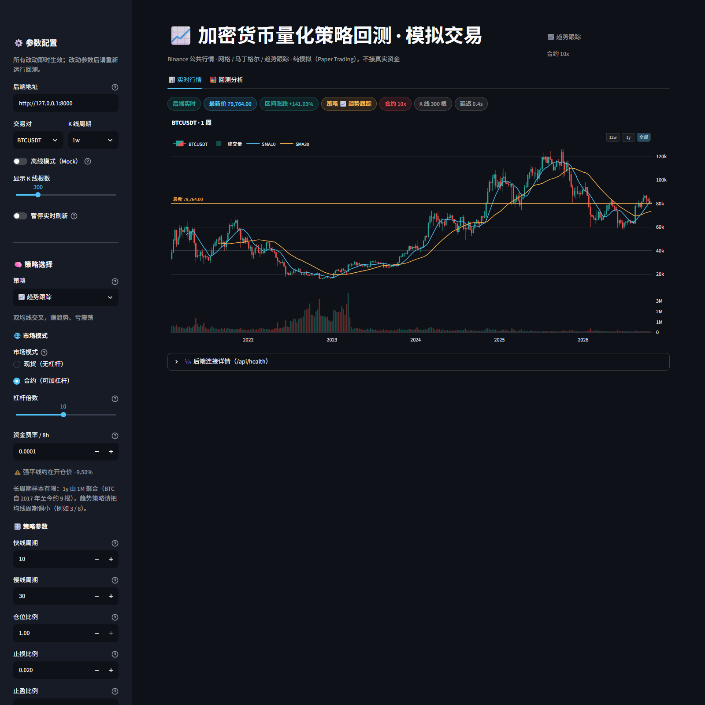
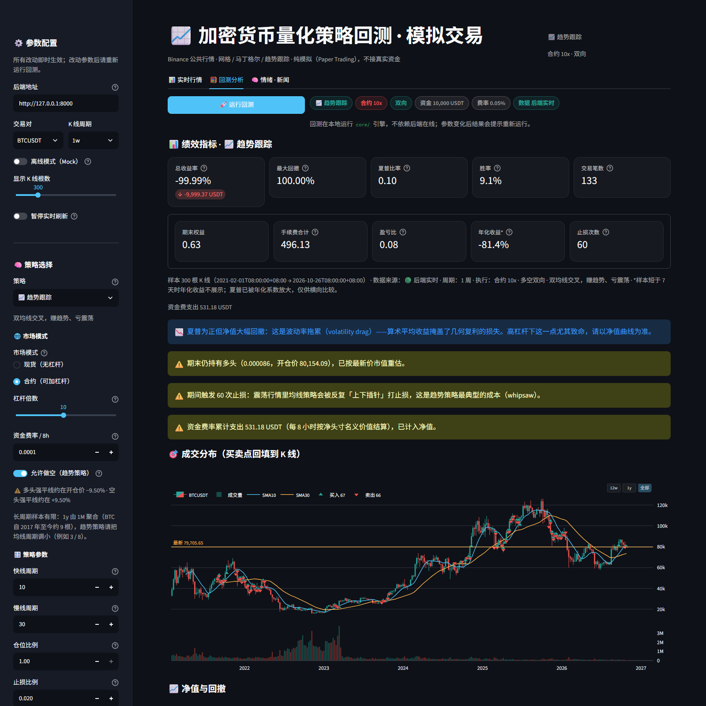
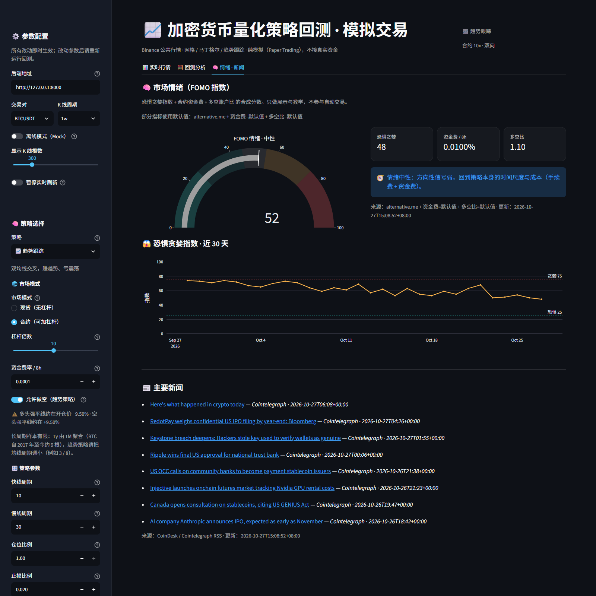
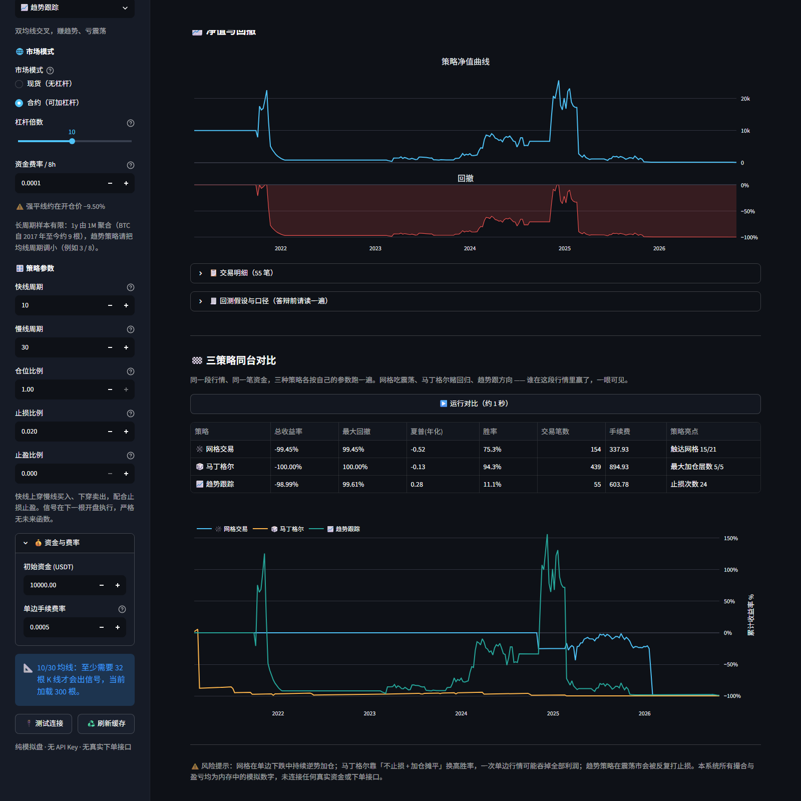

# 加密货币多策略量化回测系统（1m → 1y · 现货/合约 · 多空双向 · 情绪新闻）

> 课程项目《金融 Agent 搭建》· **纯模拟盘（Paper Trading）**
> Binance 公共行情 → FastAPI 实时服务 → Streamlit + Plotly 前端 → 三策略回测（网格 / 马丁格尔 / 趋势）→ 现货 & 合约（杠杆 / 强平 / 资金费 / 做空）→ 市场情绪与新闻面板









---

## 1. 它到底做了什么

| 能力 | 实现 | 演示时怎么体现 |
| --- | --- | --- |
| 多周期行情 | 1m / 5m / 1h / 1d / 1w / 1M 原生订阅，**1y 由月 K 聚合** | 侧边栏切周期，图上从"分钟"一路拉到"年" |
| 三套策略 | 网格 / 马丁格尔 / 趋势跟踪，统一结果契约 | 切策略，参数表单自动变化 |
| 现货 / 合约 | 现货 1:1；合约按杠杆放大名义价值，**强平 + 资金费率** | 打开合约、拉杠杆，指标卡出现强平次数与资金费 |
| **多空双向** | 合约模式下趋势策略可做空（空头收取资金费，暴涨强平） | 打开「允许做空」，空头排列自动开空 |
| **市场情绪** | 恐惧贪婪指数 + 资金费 + 多空比 → FOMO 分数 | 情绪页仪表盘 + 30 天曲线 + 做空提示 |
| **主要新闻** | CoinDesk / Cointelegraph RSS 聚合（无 Key） | 情绪页新闻列表，失败显示离线示例 |
| 策略横评 | 同一段行情跑三种策略，叠加净值曲线 | 一键回答"哪个策略更好" |
| 断线自愈 | 指数退避重连 + 心跳假死检测 + 端点自动切换 | `/api/health` 看重连次数与当前端点 |
| 行情兜底 | REST 预热 → 本地 CSV 缓存 → 本地合成行情 | 拔网线后刷新页面，图表照样有数据 |
| 可部署 | FastAPI 上云 + Streamlit Cloud 前端 | 教室用公网 URL 打开 |

**绝对不碰真实资金**：没有 API Key、没有下单接口、没有签名逻辑，`requests` 只请求公开行情。

### 界面与交互

| 设计 | 解决的问题 |
| --- | --- |
| 两级信息架构（标签页 + 侧边栏） | 主区只放结论，参数全部收进侧边栏 |
| 策略驱动参数表单 | 选马丁格尔出现"加仓倍数/最大层数"，选趋势出现"快慢线/止损" |
| 市场模式 + 杠杆 | 现货/合约一键切换，实时显示强平线（10x ≈ −9.5%） |
| 参数健康度 | 网格间距 ≤ 双边手续费红牌；马丁格尔资金需求 > 本金红牌 |
| 暂停实时刷新 | 讲解时冻结画面，参数仍即时生效 |
| 结果指纹 | 改了策略/参数/周期还没重跑，明确提示"旧结果" |
| 成交点回填 K 线 | 买卖点 + 均线叠加，策略行为一眼可见 |
| 样本保护 | < 7 天不显示年化收益；无平仓时胜率显示「—」 |
| 波动率拖累提示 | 夏普为正但净值腰斩时，主动解释"算术均值 ≠ 几何复利" |

---

## 2. 架构

```
┌──────────────── 浏览器（Streamlit） ────────────────┐
│ 侧边栏：策略 / 周期 / 现货或合约 / 杠杆 / 参数        │
│ 实时行情：K 线 + 网格线或均线 + 成交点                │
│ 回测分析：指标卡 + 净值回撤 + 三策略横评              │
│        │                                            │
│        └─ core/strategy_registry.run_backtest()      │
└──────────────────────┬──────────────────────────────┘
                       │ 每 2 秒 REST
┌──────────────────────▼──────────────────────────────┐
│ FastAPI                                              │
│  /api/latest_data（1y 现场由 1M 聚合）                │
│  /api/config（策略目录 + 执行参数）                    │
│  POST /api/backtest（strategy + params）              │
│  FeedManager：REST 预热 → CSV → 合成；WS 指数退避      │
│  CandleStore：每个 (symbol, interval) 环形缓冲         │
└──────────────────────┬──────────────────────────────┘
                       │ wss://stream.binance.com:9443 | data-stream.binance.vision
                  Binance 公共行情（只读）
```

**核心抽象**

- `core/aggregate.py`：日历对齐的聚合（周一 / 自然月 / 自然年），年 K = 12 根月 K；
- `core/execution.py`：共享账本 `Ledger`，现货 = 杠杆 1 的特例，合约 = 保证金 + 强平 + 资金费；
- `core/strategy_registry.py`：策略注册表 + 统一结果契约，前端只写一套渲染。

---

## 3. 目录结构

```
crypto-grid-quant/
├── backend/               # FastAPI + WS + 缓存 + 周期聚合接口
│   ├── external.py        # 情绪/新闻外部数据（缓存 + 负缓存 + 离线兜底）
│   └── ...                # config / store / binance_* / mock_feed / feeds / main
├── core/
│   ├── candles.py         # K 线输入规范化
│   ├── aggregate.py       # 周/月/年 K 聚合（日历对齐）
│   ├── execution.py       # 共享账本：现货/合约、杠杆、多空强平、资金费
│   ├── report.py          # 统一绩效汇总契约
│   ├── timeframe.py       # 周期定义、原生/派生划分、年化系数
│   ├── metrics.py         # 回撤 / 夏普 / 胜率 / 盈亏比
│   ├── sentiment.py       # FOMO 情绪打分（纯函数）
│   ├── news.py            # RSS 解析与去重（纯函数）
│   ├── grid_strategy.py   # 网格
│   ├── martingale.py      # 马丁格尔
│   ├── trend.py           # 趋势跟踪（可做空）
│   └── strategy_registry.py
├── frontend/app.py        # Streamlit（实时行情 / 回测 / 情绪新闻）
├── tests/                 # 92 项测试
├── scripts/               # 一键启动 + 网络自检 + 防火墙放行
├── docs/                  # 运行截图
├── requirements.txt / Procfile / render.yaml / .env.example
```

---

## 4. 快速开始

```bash
python -m venv .venv && source .venv/bin/activate   # Windows: .venv\Scripts\activate
pip install -r requirements.txt
cp .env.example .env

uvicorn backend.main:app --host 0.0.0.0 --port 8000 --reload   # 终端 A
streamlit run frontend/app.py                                  # 终端 B
```

Windows 一键：`powershell -ExecutionPolicy Bypass -File scripts\start_demo.ps1`

### 4.1 用另一台电脑/手机打开（局域网访问）

**最容易踩的坑：`localhost` / `127.0.0.1` 永远指向"你正在用的这台设备"。**

假设跑服务的主机局域网 IP 是 `10.247.110.167`：

| 在哪台设备打开 | 正确地址 | 错误写法 |
| --- | --- | --- |
| 主机自己 | `http://localhost:8501` | — |
| 同 Wi-Fi 的其它电脑/手机 | `http://10.247.110.167:8501` | `http://localhost:8501` ❌ |
| 前端侧边栏的"后端地址" | `http://10.247.110.167:8000` | `http://127.0.0.1:8000` ❌ |

三件必须同时成立的事：

1. **前端绑 0.0.0.0**：`streamlit run frontend/app.py --server.address 0.0.0.0`（start_demo.ps1 已内置）；
2. **后端也绑 0.0.0.0**：`uvicorn backend.main:app --host 0.0.0.0 --port 8000`
   —— 只绑 `127.0.0.1` 的话，别的电脑页面能开、但永远显示「离线模拟」；
3. **防火墙放行 8000 / 8501**：管理员 PowerShell 运行 `scripts\allow_firewall.ps1`。

自检：`powershell -ExecutionPolicy Bypass -File scripts\network_check.ps1`
会打印本机 IP、端口绑定、防火墙规则和应使用的访问地址。

> 校园网/公共 Wi-Fi 常有 **AP 隔离**（设备之间互访被禁），此时防火墙放行也没用：
> 改用手机热点，或直接走云端部署（见第 10 节）。

---

## 5. 运行模式

| `RUN_MODE` | 行为 |
| --- | --- |
| `live`（默认） | 连 Binance 实时行情，主端点失败自动切 `data-stream.binance.vision` |
| `mock` | 不联网，本地随机游走（教室断网兜底） |

---

## 6. 周期与数据来源

| 周期 | 来源 | 说明 |
| --- | --- | --- |
| `1m` `5m` `1h` `1d` `1w` `1M` | Binance WS + REST 原生 | 订阅组合流，断线重连 |
| `1y` | **由 `1M` 聚合** | 币安没有年 K 流；按自然年 1 月 1 日对齐，BTC 约 10 根 |

> ⚠️ **大小写敏感**：`1m` 是分钟、`1M` 是月，代码里禁止对周期做 `.lower()`。
> 这一条踩过坑：早期版本把 `1M` 归一化成 `1m`，导致月 K 和分钟 K 抢同一个缓存键。

长周期只有几十到几百根，趋势策略请相应调小均线周期（例如 3 / 8），否则会一直等不到信号。

---

## 7. 现货 vs 合约（本轮新增）

| 维度 | 现货 `mode="spot"` | 合约 `mode="futures"` |
| --- | --- | --- |
| 保证金 | 1:1，`margin = notional` | `margin = notional / leverage` |
| 手续费 | 默认 0.1% | 默认 0.05%（按名义价值） |
| 强平 | 无 | 多头：`entry × (1 − 1/杠杆 + 维持保证金率)`；空头：`entry × (1 + 1/杠杆 − 维持保证金率)` |
| 资金费 | 无 | 每 8 小时按**净头寸**名义价值结算：多头支付、空头收取 |
| 权益公式 | `现金 + 持仓市值` | `可用现金 + 占用保证金 + 未实现盈亏`（多空方向相反） |

**强平线速查**（维持保证金率 0.5%）：

| 杠杆 | 多头反向多少爆仓 | 空头正向多少爆仓 |
| --- | --- | --- |
| 2x | −49.5% | +49.5% |
| 5x | −19.5% | +19.5% |
| 10x | −9.5% | +9.5% |
| 20x | −4.5% | +4.5% |

> 强平损失 = 该笔仓位的保证金（付过的手续费不退），现金可以为负（资金费从保证金里扣）。
> 权益下限钳制在 0，避免出现负净值。

### 7.1 做空分支（本轮新增）

- 只有**合约模式**能开空；现货模式在参数校验阶段直接拒绝（`现货模式不支持做空`）；
- 趋势策略在 `direction="long_short"` 时才是双向：均线空头排列 → 下一根开盘开空，
  涨回慢线上方 → 平空；止损价在开仓价**上方**，止盈价在**下方**；
- 空头强平看**当根最高价**（多头看最低价），强平后保证金全部损失；
- 空头持仓收到资金费（`funding_rate_8h > 0` 时），因此高 FOMO 时做空有"持有收益"，
  但逼空风险最高——这条直接写进了情绪页提示；
- 胜率口径同步修正：**多空两侧的平仓单都计入胜率**（原先只统计 `sell`，会漏掉空头平仓）。

网格与马丁格尔仍只做多：它们是"摊薄/累积"型策略，做空需要另一套风控模型（逼空、借币成本），
强行搬过来只会得到一个看起来能跑、实际没意义的引擎。

---

## 8. 三套策略的口径

### 8.1 网格（Grid）

1. 区间等距切 `grid_count + 1` 条线；
2. 向下穿越买入、向上穿越卖出**最近一档已持仓**；
3. **每条线最多持有一份**（卖出后才重新挂单）；
4. 每格保证金 = `初始资金 / 网格数`，合约模式放大为 `×杠杆` 的名义价值；
5. 单根 K 线内按 `open → 低 → 高 → close` 模拟。

**风险**：震荡赚钱；单边下跌持续逆势加仓 —— 上杠杆后"越跌越买"会直接撞上强平线。

### 8.2 马丁格尔（Martingale）

1. 空仓建首仓；
2. 相对上次成交价每跌 `drop_pct` 加仓，保证金 = `首仓 × multiplier^层数`（几何级数）；
3. 持仓均价上涨 `take_profit_pct` 全部止盈，下一根重新开始；
4. 最多 `max_entries` 层，资金不足跳过并告警；
5. 只做多、不设止损；合约模式下按最低价检查强平。

**风险**：胜率 90%+，但单边下跌一次吞掉几十次利润；上杠杆后是"加仓加到爆仓"。

### 8.3 趋势跟踪（Trend）

1. 收盘价算 SMA 快 / 慢线；
2. 快线在慢线上方 → **下一根开盘**做多；跌到下方 → 下一根开盘平多；
3. 合约 + `long_short` 时，空头排列 → 下一根开盘**做空**，涨回上方平空；
4. 止损 / 止盈按价格触碰近似成交（多头看下跌、空头看上涨）；
5. 严格无未来函数（测试锁死"成交价 = 该 K 线开盘价"）。

**风险**：趋势里赚大钱，震荡里被反复打止损（whipsaw）。

### 8.4 指标口径

| 指标 | 定义 | 注意 |
| --- | --- | --- |
| 总收益率 | `(期末权益 − 初始资金) / 初始资金` | 含未平仓市值 |
| 最大回撤 | 净值相对历史峰值的最大跌幅 | 逐 K 线 |
| 夏普 | `mean(逐K线收益) / std × sqrt(一年K线数)` | 1m ≈ ×725、1w ≈ ×7.2；短样本仅供参考 |
| 胜率 | 盈利平仓 / 平仓总数 | 无平仓显示「—」 |
| 盈亏比 | 总盈利 / 总亏损 | 无亏损显示「∞」 |
| 年化收益 | 复利折算 | 样本 < 7 天不展示 |
| 强平次数 / 资金费 | 合约专属 | 出现在副指标与告警里 |

> **波动率拖累**：算术均值夏普为正、几何复利却可能腰斩。页面在 `总收益 < −20% 且夏普 > 0` 时会主动提示，
> 这不是 bug，而是高波动 + 杠杆的数学结果。

### 8.5 已知局限

- 未计滑点、挂单排队、限频；强平按当根最低价近似；
- 合约只做多，不做空、不模拟逐仓/全仓切换与自动减仓（ADL）；
- 资金费按固定费率近似，未接真实资金费历史；
- 长周期样本少（月 K 111 根、年 K 10 根），统计意义有限。

---

## 8.5 市场情绪（FOMO）与新闻

### 数据来源（全部免费、无 Key）

| 数据 | 来源 | 兜底 |
| --- | --- | --- |
| 恐惧贪婪指数 | `api.alternative.me/fng`（近 30 天） | 离线示例曲线 |
| 资金费率 | Binance U 本位 `premiumIndex` | 默认 0.01% / 8h |
| 多空账户比 | Binance `globalLongShortAccountRatio` | 默认 1.10 |
| 新闻 | CoinDesk / Cointelegraph RSS | 明确标注的离线示例 |

### FOMO 分数怎么算（`core/sentiment.py`）

```
score = 恐惧贪婪指数(0~100)
      + clamp(资金费 / 0.05%, -1, 1) × 15
      + clamp(多空比 − 1, -1, 1) × 10
最终钳制到 0~100
```

| 区间 | 标签 | 与做空的关系 |
| --- | --- | --- |
| 0 ~ 25 | 极度恐惧 | 空头也拥挤，追空容易吃反弹 |
| 25 ~ 45 | 恐惧 | — |
| 45 ~ 55 | 中性 | 方向信号弱，回到策略本身 |
| 55 ~ 75 | 贪婪 | — |
| 75 ~ 100 | 极度贪婪 | 空头可收资金费，但逼空风险最高 |

页面上的仪表盘、30 天曲线、三个分量指标与一句话建议，都来自这一个纯函数；单测覆盖标签边界与钳制。

### 新闻

- RSS 解析在 `core/news.py`（纯函数，可用固定 XML 单测）；
- 网络请求在 `backend/external.py`：5 分钟缓存 + 60 秒**负缓存**（失败后不再反复超时）+ 过期缓存兜底；
- 后端启动时后台预热，避免第一个页面请求卡在第三方超时上；
- 新闻源不可达时返回**明确标注的「离线示例」**，不假装是实时新闻。

---

## 9. REST 接口

| 方法 | 路径 | 说明 |
| --- | --- | --- |
| GET | `/api/health` | 连接状态、重连次数、端点、各周期缓存量 |
| GET | `/api/config` | 交易对、周期、策略目录、执行参数（mode/leverage/funding） |
| GET | `/api/latest_data?symbol=BTCUSDT&interval=1y&limit=30` | 任意支持周期；1y 自动由 1M 聚合 |
| POST | `/api/backtest` | `strategy` + `params`（含 mode/leverage/funding_rate_8h/direction） |
| GET | `/api/sentiment?symbol=BTCUSDT` | FOMO 分数 + 分量 + 30 天历史 + 建议 |
| GET | `/api/news?limit=8` | RSS 聚合新闻（失败返回离线示例） |

```bash
# 周 K + 合约 10x + 趋势策略（双向）
curl -X POST http://127.0.0.1:8000/api/backtest \
  -H "Content-Type: application/json" \
  -d '{"strategy":"trend","symbol":"BTCUSDT","interval":"1w","limit":300,
       "params":{"fast_ma":10,"slow_ma":30,"stop_loss_pct":0.02,
                 "mode":"futures","leverage":10,"funding_rate_8h":0.0001,
                 "direction":"long_short"}}'
```

---

## 10. 云端部署

### 10.1 临时公网演示（无账号，已实测）

不想注册 Render / Streamlit Cloud 时，用 SSH 反向隧道把本机 8501 暴露到公网：

```powershell
# 1) 先启动服务
powershell -ExecutionPolicy Bypass -File scripts\start_demo.ps1

# 2) 另开一个窗口，建立公网隧道（Pinggy 免费版）
powershell -ExecutionPolicy Bypass -File scripts\start_public_tunnel.ps1
```

连上后会打印两个 `https://…` 地址，任选其一分享。**首次打开需要点一下页面上的「Enter site」**（免费隧道的中转提示）。

实测截图：[docs/screenshot_cloud.png](docs/screenshot_cloud.png)（通过公网地址打开并跑完一次回测）。

限制（必须知道）：

| 限制 | 说明 |
| --- | --- |
| 60 分钟 | 免费会话到期自动断开，重新运行脚本会得到新地址 |
| 本机必须开机 | 隧道只是转发，电脑关机/休眠即失效 |
| 一次点击 | 新浏览器首次访问要过 Pinggy 的提示页 |
| 无鉴权 | 拿到链接的人都能访问，仅适合课堂演示 |

### 10.2 持久化：Render + Streamlit Cloud

- **后端** Render/Railway：`uvicorn backend.main:app --host 0.0.0.0 --port $PORT`，健康检查 `/api/health`；- **前端** Streamlit Cloud：Main file `frontend/app.py`，Secrets 填 `BACKEND_BASE_URL`；
- 免费套餐建议 `SYMBOLS=BTCUSDT,ETHUSDT`、`INTERVALS=1m,1d,1w`，省 WS 与内存；
- 演示前 5 分钟唤醒后端（免费套餐会休眠）。

检查清单：`/api/health` 为 `ok`、`/api/config` 里 `strategies` 三个、`trading_modes` 两个、前端状态条为「后端实时」。

---

## 11. 教室演示动线（3 分钟）

1. 打开页面：状态条「后端实时 / 合约 10x / 策略」；
2. 侧边栏把周期从 `1m` 切到 `1w`，再切 `1M`、`1y` —— **同一套策略在不同时间尺度下的表现差异**；
3. 切策略（网格 → 马丁 → 趋势），参数表单随之变化；
4. 打开「合约」，把杠杆拉到 10x，指出强平线提示（多头 −9.5% / 空头 +9.5%），并保持「允许做空」开启；
5. 「回测分析」→ 运行回测：讲指标卡、强平次数、资金费，以及空头开仓/平仓的成交点；
6. 「运行对比」，三策略同台；
7. 切到「🧠 情绪 · 新闻」：FOMO 仪表盘、30 天恐惧贪婪曲线、三条分量指标、实时新闻标题；
8. 展开「回测假设」，主动交代未来函数、手续费、强平近似、资金费结算。

> 教室数据提示：周 K 300 根 ≈ 6 年；月 K 111 根；年 K 10 根。别用 10 根年 K 断言策略优劣。

---

## 12. 防翻车话术

| 场景 | 动作 | 话术 |
| --- | --- | --- |
| 连不上币安 | 开「离线模式」 | "三级降级：实时→缓存→合成，策略引擎完全一致" |
| 后端冷启动 | 先讲降级再跑回测 | "回测在前端本地跑，不依赖后端" |
| 老师问"杠杆怎么算" | 指强平线提示 | "多头 `entry×(1−1/杠杆+MMR)`、空头 `entry×(1+1/杠杆−MMR)`，10x 时两端各 9.5%" |
| 老师问"为什么资金费这么多" | 指副指标 | "周 K 持仓按 8 小时结算，10x 下名义价值是权益的 10 倍，资金费很轻松超过手续费" |
| 老师问"做空赚什么" | 打开空头成交记录 | "价格下跌赚价差，同时**收取**资金费；代价是暴涨会被强平，所以必须带止损" |
| 老师问"情绪数据哪来的" | 指来源行 | "恐惧贪婪指数来自 alternative.me，资金费/多空比来自币安合约接口；任何一项挂了都会标注并降级" |
| 老师问"新闻是真的吗" | 看来源标注 | "RSS 实时抓取；抓不到时明确标注『离线示例』，不会把示例当新闻" |
| 老师问"夏普正为什么还亏 99%" | 指波动率提示 | "算术均值被高波动放大，几何复利被方差吃掉——这就是波动率拖累" |

---

## 13. 测试

```bash
pytest -q    # 92 passed
```

覆盖：三引擎成交/止损/加仓/止盈/做空、共享账本（现货等价、杠杆放大、多空强平、资金费收付）、
周期聚合（周一周对齐、自然月/年）、情绪打分（边界/钳制/缺失分量）、RSS 解析（去重/排序/坏 XML）、
REST 契约（1y 派生、合约参数、情绪/新闻端点）、前端 AppTest（切策略/切合约/周 K 渲染/周期透传）。

---

## 14. 常见问题

**Q：换了电脑就打不开前端网址？**
A：按顺序排查：
1. 地址不能用 `localhost`：它指向"当前这台电脑"。用主机的局域网 IP（`ipconfig` 看 IPv4，例如 `10.247.110.167`），即 `http://10.247.110.167:8501`；
2. 前端必须绑 `0.0.0.0`（`--server.address 0.0.0.0`），后端必须绑 `0.0.0.0`（`--host 0.0.0.0`）；
3. Windows 防火墙要放行 8000/8501：管理员运行 `scripts\allow_firewall.ps1`；
4. 两台设备必须在同一网段（IP 前三段相同），且没有开 VPN；
5. 若仍不通，多半是校园网 AP 隔离 —— 换手机热点或云端部署。
一键自检：`powershell -ExecutionPolicy Bypass -File scripts\network_check.ps1`。

**Q：页面能打开，但一直显示「离线模拟」？**
A：前端侧边栏的「后端地址」填的还是 `127.0.0.1:8000`。改成主机的局域网 IP（`http://<IP>:8000`）；
或者用 `start_demo.ps1` 启动，它会自动把默认后端地址设成局域网 IP。

**Q：1y 只有 10 根？**
A：BTC 2017 年才有数据，一年一根就是 10 根。长周期只能做"大级别趋势"演示，不适合短均线。

**Q：为什么 1M 和 1m 不能自动区分？**
A：这是两个不同周期，代码保留大小写；`INTERVALS` 环境变量里请写 `1M`。

**Q：合约回测出现 99% 亏损？**
A：10x + 周 K + 2% 止损，止损跳空 + 资金费 + 手续费会把本金磨光。这正是杠杆的真实代价。

**Q：空头为什么也会爆仓？**
A：空头在价格上涨时亏损，强平价 = `entry × (1 + 1/杠杆 − 维持保证金率)`，10x 时上涨 9.5% 即保证金归零。测试里用单根暴力拉升验证了这条路径。

**Q：情绪数据是实时的吗？**
A：优先实时（5 分钟缓存）；外部接口不可达时用缓存/默认值，并在页面上标注「部分指标使用默认值」或「离线示例」。

**Q：新闻会编造吗？**
A：不会。抓不到就展示明确标注的离线示例，且示例标题带「离线示例」前缀。

**Q：夏普是正数但亏钱？**
A：见"波动率拖累"，页面会主动提示；以净值曲线与最大回撤为准。

---

## 15. 可以继续做的方向

- 合约空头加入资金费历史曲线与借币成本；
- 逐仓/全仓切换、自动减仓（ADL）、真实资金费历史；
- 情绪指标与策略联动（例如 FOMO > 80 时自动降低杠杆）；
- Walk-forward 参数寻优 + 过拟合检验；
- 多策略组合（按波动率分配资金）。

---

## 16. 免责声明

仅用于课程教学：不构成投资建议；全部为内存中的模拟撮合，不下真实订单；杠杆会放大亏损，回测不代表未来。

### 10.3 用 Gitee 托管可以吗？

**可以存代码，但不能直接驱动 Streamlit Cloud。**

| 平台 / 能力 | 支持 Gitee 仓库？ | 说明 |
| --- | --- | --- |
| Gitee 代码托管 | ✅ | 免费、国内快，适合做主力仓库 |
| Gitee Pages | ⚠️ | **只能托管静态页面**，跑不了 Streamlit / FastAPI |
| Gitee Go | ⚠️ | CI/CD 流水线，不是运行环境 |
| Streamlit Community Cloud | ❌ | 只支持 GitHub 仓库（GitHub OAuth） |
| Render / Railway | ✅（有限） | 支持 "Public Git repository" 填 Gitee HTTPS 地址；但海外构建机访问 gitee.com 可能慢或不稳 |
| 国内云服务器（阿里云/腾讯云轻量） | ✅ | 自己 `git clone` + 运行，最自主；大陆 80/443 需备案，可用 8501/8000 非标端口 |

**推荐组合（省事且稳定）**

1. **Gitee 做主仓库**（日常提交、课堂展示）；
2. **同步一份到 GitHub**，给 Streamlit Cloud 用；
3. 后端放 Render（从 GitHub 或 Gitee 公开地址拉取），前端放 Streamlit Cloud，Secrets 里填后端公网地址。

```bash
# 本地同时推两个远端（先各自建好空仓库）
git remote add gitee  git@gitee.com:<你的账号>/crypto-grid-quant.git
git remote add github git@github.com:<你的账号>/crypto-grid-quant.git
git push gitee main
git push github main
```

**如果只能用 Gitee（不想碰 GitHub）**

- 后端：Render 新建 Web Service → 选 "Public Git repository" → 填 Gitee 的 `https://gitee.com/<账号>/<仓库>.git`（仓库必须公开）；
- 前端：Streamlit Cloud 用不了 → 改成本机/云服务器跑 `streamlit run frontend/app.py --server.address 0.0.0.0`，再用第 10.1 节的隧道，或直接部署在云服务器上；
- 云服务器方案需要 Docker 或系统 Python 环境，本项目未附带 Dockerfile（本机无 Docker，未实测，不写没验证过的东西）。

> 一句话：**Gitee 适合存代码，Streamlit Cloud 只认 GitHub；想全用国内生态，就得自己买一台云服务器。**
